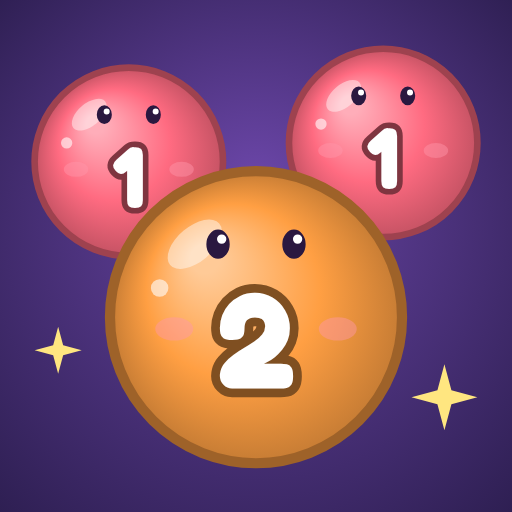
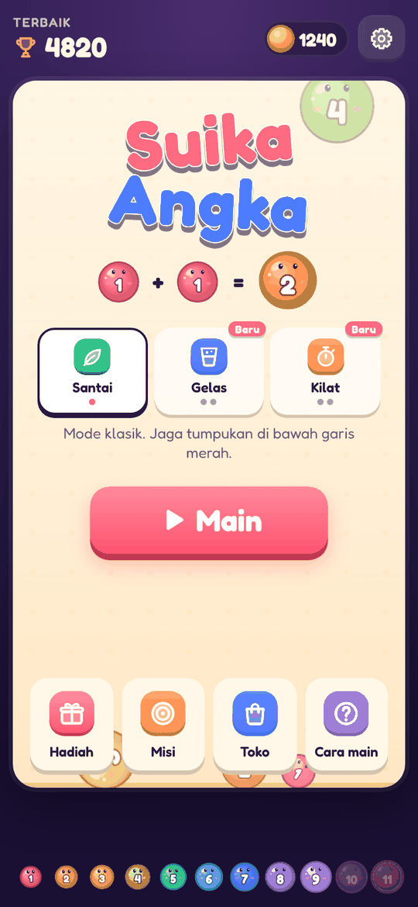
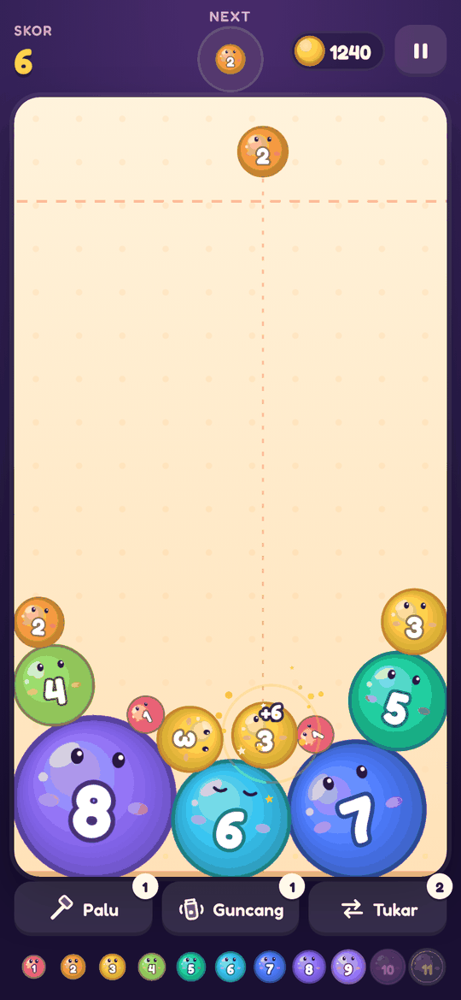
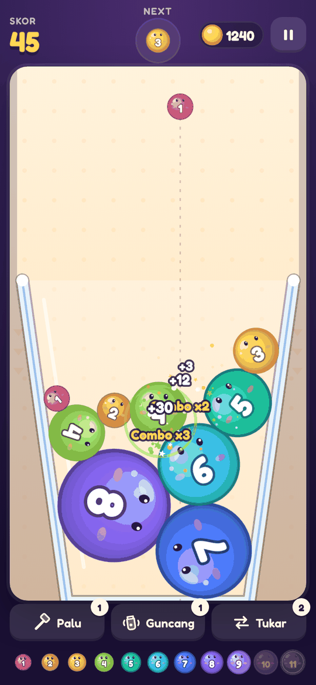
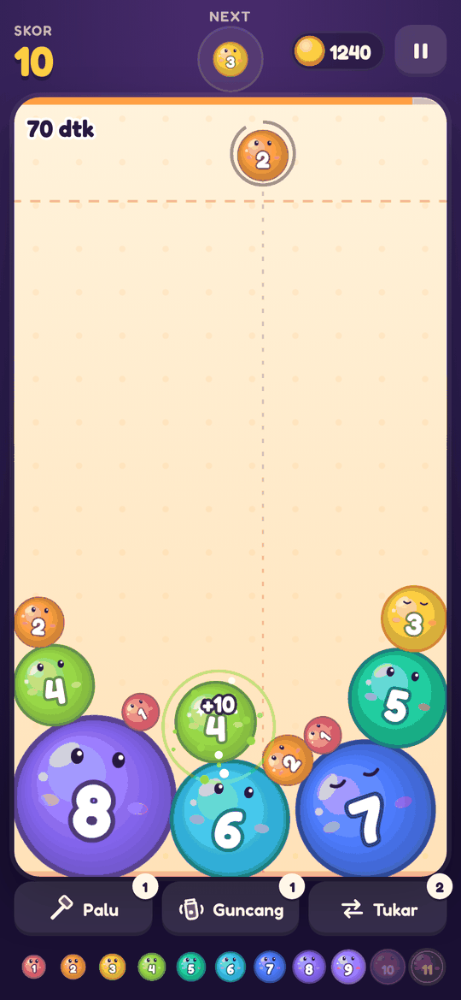
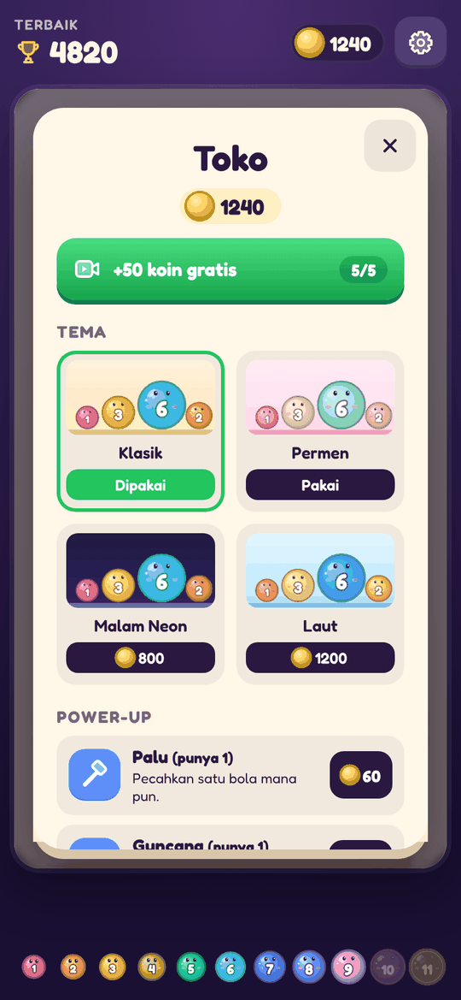
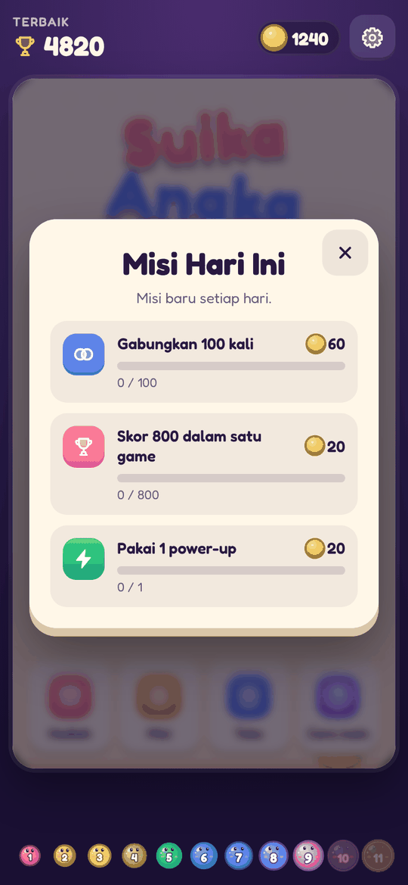

<div align="center">



# Suika Angka

**Game merge angka ala Suika Game, di browser dan Android.**
Jatuhkan bola angka ke dalam toples, gabungkan dua angka yang sama, dan kejar angka 11.

[](https://lav-studio-org.github.io/suika-merge/)
[](https://github.com/Lav-Studio-Org/suika-merge/releases/tag/android-latest)

[](https://github.com/Lav-Studio-Org/suika-merge/actions/workflows/pages.yml)
[](https://github.com/Lav-Studio-Org/suika-merge/actions/workflows/android.yml)







</div>

## Cara main

1. Geser untuk membidik, lepas untuk menjatuhkan bola.
2. Dua angka **sama** yang bersentuhan bergabung jadi angka berikutnya: `1 + 1 = 2`, `2 + 2 = 3`, dan seterusnya sampai `11`.
3. Dua angka 11 yang bertemu lenyap dengan bonus besar.
4. Gabungan beruntun memberi **combo** dan skor berlipat. Jangan biarkan tumpukan melewati garis merah.

## Mode permainan

| Mode | Aturan |
|---|---|
| **Santai** | Mode klasik. Jaga tumpukan di bawah garis merah. |
| **Gelas** | Gelas tanpa tutup. Kalah kalau ada bola yang tumpah. Koin ×1,5. |
| **Kilat** | 75 detik, tiap bola memakan waktu. Bentuk angka 6 ke atas untuk tambah waktu. Koin ×1,5. |

Rekor disimpan terpisah untuk tiap mode.

## Fitur

- **Fisika nyata** (Matter.js), 11 bola angka berwajah lucu, partikel, combo, dan getar layar.
- **3 power-up**: Palu (pecahkan satu bola), Guncang, dan Tukar.
- **Koin, hadiah harian 7 hari, 3 misi harian**, dan **toko tema** (Klasik, Permen, Malam Neon, Laut).
- Tutorial di permainan pertama, musik dan efek suara yang disintesis langsung di browser.
- **Iklan yang tidak mengganggu**: revive, 2× koin, power-up gratis, koin gratis, dan interstitial yang dibatasi frekuensinya.
- **Nyaman di HP**: kontrol sentuh, layar kecil, tombol back Android, bisa offline, bisa dipasang sebagai PWA.

<div align="center">


</div>

## Teknologi

HTML, CSS, dan JavaScript biasa untuk web (tanpa build), dibungkus Capacitor untuk Android.

| Path | Isi |
|---|---|
| `index.html`, `style.css` | Tampilan, layar menu, sprite ikon |
| `js/game.js` | Fisika, render, alur game, UI |
| `js/meta.js` | Profil pemain, mode, koin, tema, misi, hadiah harian |
| `js/ads.js` | Semua titik iklan dan aturan frekuensinya |
| `js/native.js`, `js/ads-config.js` | AdMob dan tombol back di aplikasi Android |
| `js/audio.js` | Efek suara dan musik (Web Audio) |
| `vendor/` | Matter.js 0.20.0 |
| `android/` | Proyek Android (Capacitor 8) |
| `store/` | Ikon, feature graphic, dan screenshot Play Store |
| `docs/` | Panduan Play Store, audit UI/UX, screenshot README |

## Jalankan lokal

```sh
git clone https://github.com/Lav-Studio-Org/suika-merge.git
cd suika-merge
python3 -m http.server 8765   # lalu buka http://localhost:8765/
```

### Android

```sh
npm ci
npm run android:debug     # butuh Android SDK dan JDK 21
npm run android:release   # AAB untuk Play Store (butuh keystore)
```

Atau biarkan GitHub Actions yang membangunnya: setiap push ke `main` menghasilkan APK debug di rilis [`android-latest`](https://github.com/Lav-Studio-Org/suika-merge/releases/tag/android-latest), dan AAB bertanda tangan kalau secret keystore sudah diisi. Panduan lengkap rilis Play Store dan strategi iklan ada di [`docs/PLAY_STORE.md`](docs/PLAY_STORE.md).

## Deploy

Setiap push ke `main` disalin ke branch `gh-pages` oleh `.github/workflows/pages.yml`, lalu disajikan GitHub Pages di https://lav-studio-org.github.io/suika-merge/. Kebijakan privasi: [`privacy.html`](https://lav-studio-org.github.io/suika-merge/privacy.html).

## Lisensi aset

Font [Fredoka](https://fonts.google.com/specimen/Fredoka) (SIL Open Font License). [Matter.js](https://brm.io/matter-js/) (MIT).
